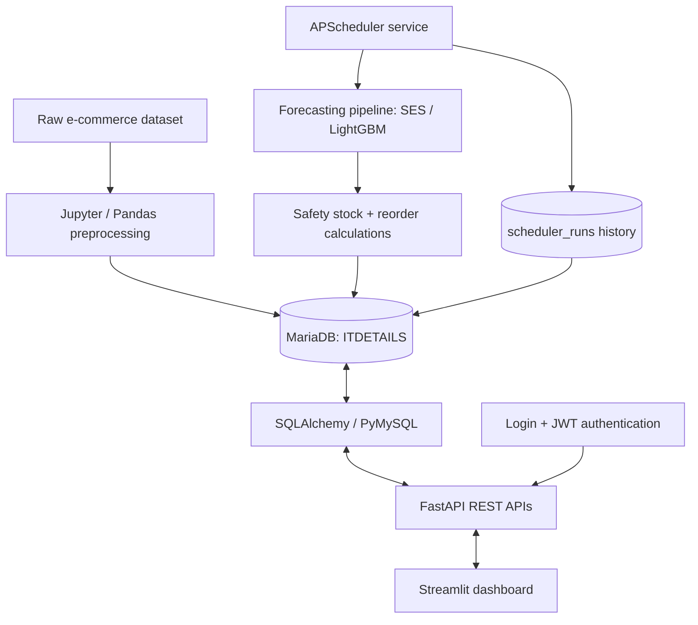

# E-Commerce Database Management & Inventory Optimization

**A database-driven inventory analytics and demand-forecasting system**  
*Academic DBMS Course Project · Indian Institute of Technology Guwahati · Team of 4*

The project transforms a large e-commerce dataset into a structured **MariaDB** database and exposes product, order, inventory, warehouse, and forecasting information through **FastAPI** and a multi-page **Streamlit** dashboard. A scheduled machine-learning pipeline generates weekly demand forecasts and stock-replenishment recommendations, while **JWT-based role-based access control (RBAC)** limits warehouse managers to their assigned warehouse.

> **Project scope:** Relational database design, data preprocessing and ingestion, SQL analytics, demand forecasting, inventory decision support, API development, authentication/authorization, and interactive visualization. This is an academic prototype; it is not presented as a deployed production inventory system.

---

## Contents

1. [Problem statement and objectives](#problem-statement-and-objectives)
2. [Key features](#key-features)
3. [Technology stack](#technology-stack)
4. [System architecture](#system-architecture)
5. [Dataset and database design](#dataset-and-database-design)
6. [Forecasting and inventory recommendations](#forecasting-and-inventory-recommendations)
7. [Authentication and access control](#authentication-and-access-control)
8. [Repository structure](#repository-structure)
9. [Installation and local setup](#installation-and-local-setup)
10. [API reference](#api-reference)
11. [Dashboard pages](#dashboard-pages)
12. [Verification and demonstration](#verification-and-demonstration)
13. [Implementation status and limitations](#implementation-status-and-limitations)
14. [Team collaboration and academic scope](#team-collaboration-and-academic-scope)

---

## Problem statement and objectives

E-commerce platforms generate large volumes of transactional data across products, customers, warehouses, and orders. Keeping this information in one wide dataset makes querying, validation, and inventory planning difficult. In addition, warehouses need a practical way to understand historical demand and estimate future replenishment requirements.

This project aims to:

- **Design a relational database** with logically separated entities, primary/foreign keys, and integrity constraints.
- **Ingest and validate** transactional data at scale, using repeatable preprocessing and chunked database uploads.
- **Expose REST APIs** for product, warehouse, inventory, order, analytics, and recommendation data.
- **Forecast weekly demand** and translate predictions into safety-stock, reorder-quantity, and status indicators.
- **Automate forecast generation** and retain execution history for monitoring and troubleshooting.
- **Enforce warehouse-level authorization**, with restricted manager access and broader administrator access.
- **Visualize results** through a Streamlit interface rather than requiring users to write SQL queries.

## Key features

| Area | Functionality |
| --- | --- |
| Data engineering | Pandas/Jupyter preprocessing, relational table extraction, validation, chunked/resumable MariaDB imports |
| Database management | SQL joins, filtered listings, aggregated analytics, keys and constraints |
| Demand forecasting | Simple Exponential Smoothing (SES) and LightGBM evaluated on a holdout period |
| Inventory planning | Weekly predicted demand, safety stock, reorder quantity and four recommendation statuses |
| Automation | APScheduler-driven weekly pipeline with manual-trigger API and execution history |
| Backend | FastAPI, SQLAlchemy sessions, parameterized SQL, Pydantic response schemas |
| Security | bcrypt password hashing, JWT login, Admin/Manager RBAC and warehouse assignment checks |
| Frontend | Recommendation lookup, Warehouse Stock & Demand, and Admin Forecast Scheduler pages |

## Technology stack

| Layer | Technologies |
| --- | --- |
| Language and analysis | Python, SQL, Pandas, NumPy, Jupyter Notebook |
| Database | MariaDB (MySQL-compatible) |
| Backend | FastAPI, Uvicorn, SQLAlchemy, PyMySQL, Pydantic |
| Authentication | JWT (PyJWT), bcrypt, OAuth2 password-form login |
| Forecasting | statsmodels (SES), LightGBM, scikit-learn |
| Scheduling | APScheduler 3.x |
| Frontend | Streamlit, Requests |
| Collaboration | Git, GitHub, feature branches and pull requests |

## System architecture



**Responsibility separation:**

1. **Data layer:** MariaDB stores normalized transactional data, inventory snapshots, forecasts, account mappings and scheduler history.
2. **Prediction layer:** The `auto_scheduler` package reads order history, evaluates forecasting models, calculates inventory metrics and writes recommendations.
3. **API layer:** FastAPI retrieves records and enforces authentication and authorization. Read-only recommendation endpoints do not train the ML models themselves.
4. **Presentation layer:** Streamlit communicates with FastAPI over HTTP; database credentials are not required in the frontend.

## Dataset and database design

### Data preparation

The source dataset was described during development as approximately **1 million records with 62 attributes**, including transactions involving multiple cities and product categories. Data was cleaned and split into relational entities through Python/Pandas notebooks. A historical preparation window of **3 February 2024 to 3 August 2025** was used for the project dataset.

During ingestion, large imports were made more reliable using **bounded batches, retry/resume logic, row-count verification**, and corrected numeric SQL types such as `DECIMAL(12,2)` for monetary values.

Earlier development checks reported **48 products**, **50 warehouses**, and **2,400 product–warehouse inventory pairs**. These are historical project observations, not dynamically refreshed statistics.

> **Stock interpretation:** The stored `inventory.stock_quantity` was derived from rounded mean historical stock values per product–warehouse pair. It is **not a live stock counter**. Forecast-based replenishment figures must therefore be interpreted as decision-support outputs for the academic dataset, not real-time procurement instructions.

### Database overview

**Database name:** `ITDETAILS`

The project has **12 observed tables**, grouped by responsibility:

| Table | Primary identifier / key | Purpose |
| --- | --- | --- |
| `customers` | `customer_id` | Customer profile, location, segment and loyalty attributes |
| `product` | `product_id` | Product names, categories, ratings and unit prices |
| `warehouse` | `warehouse_id` | Warehouse master and location data |
| `orders` | `order_id` | Order date, customer, payment and order status |
| `order_items` | (`order_id`, `product_id`, `warehouse_id`) | Line-item quantities, discounts and financial values |
| `shipment` | `order_id` | Shipping method, cost, delivery time and delivery status |
| `inventory` | `inventory_id` | Stored stock by product and warehouse |
| `recommendation` | (`product_id`, `warehouse_id`, `forecast_date`) | Dated demand forecasts and inventory decisions |
| `prediction_log` | `prediction_id` | Prediction logging/history structure; not part of the verified scheduler write path |
| `app_users` | `user_id` | Login credentials, role and active status |
| `user_warehouse_access` | `user_id` (warehouse unique) | Manager-to-warehouse authorization mapping |
| `scheduler_runs` | `run_id` | Forecast execution status, timestamps, selected model and evaluation metrics |

**Important logical relationships** (used in joins and, where defined, enforced by foreign-key constraints) include:

- `orders.customer_id → customers.customer_id`
- `order_items.order_id → orders.order_id`; `order_items.product_id → product.product_id`; `order_items.warehouse_id → warehouse.warehouse_id`
- `inventory.product_id → product.product_id`; `inventory.warehouse_id → warehouse.warehouse_id`
- `shipment.order_id → orders.order_id`
- `recommendation.product_id → product.product_id`; `recommendation.warehouse_id → warehouse.warehouse_id`
- `user_warehouse_access.user_id → app_users.user_id`; `user_warehouse_access.warehouse_id → warehouse.warehouse_id`

The `recommendation` table uses a **composite primary key** so the same product in the same warehouse can have multiple forecast dates without duplicate records for one date. Database checks restrict predicted demand, safety stock and reorder quantity to nonnegative values, and status to `OK`, `REORDER_NOW`, `CRITICAL`, or `OVERSHOOT`.

The authorization mapping enforces one manager assignment per warehouse in the implemented design. Administrators are not restricted to a single warehouse.

### Example database queries

**Warehouse inventory joined to product information:**

```sql
SELECT i.product_id, p.product_name, i.stock_quantity
FROM inventory AS i
JOIN product AS p ON p.product_id = i.product_id
WHERE i.warehouse_id = :warehouse_id
ORDER BY p.product_name;
```

**Forecast history for a product and warehouse:**

```sql
SELECT forecast_date, predicted_demand,
       safety_stock, reorder_qty, status
FROM recommendation
WHERE product_id = :product_id
  AND warehouse_id = :warehouse_id
ORDER BY forecast_date DESC;
```

The `:parameter` notation illustrates **SQLAlchemy named bind parameters**. It is not MariaDB console syntax; FastAPI executes these queries using `sqlalchemy.text(...)` and a parameter dictionary.

## Forecasting and inventory recommendations

The project includes a teammate-developed Python pipeline in `auto_scheduler/`, integrated with the main FastAPI backend through `backend/app/services/scheduler_service.py`.

### Weekly ML pipeline

1. Determine the run date and open an entry in `scheduler_runs`.
2. Fetch a **rolling 52-week window anchored to the latest available order date**, so historical/static datasets can be used.
3. Aggregate order quantities into product–warehouse **weekly time series**.
4. Use the earlier **approximately 44 weeks for training** and the final **8 weeks for holdout evaluation**.
5. Evaluate **SES** and **LightGBM** against observed holdout quantities.
6. Compare holdout **WMAPE, RMSE and MAE**; the current `model_selector.py` chooses based primarily on the accuracy measure derived from WMAPE, with fallback rules.
7. Refit the selected model using the full available 52-week window and generate a **four-week forecast**.
8. Anchor forecasts to upcoming calendar weeks, calculate inventory metrics and upsert results into `recommendation`.
9. Update `scheduler_runs` with success/failure, model, metrics, records written and any error message.

**Evaluation metrics:**

$$
\mathrm{WMAPE}=\frac{\sum_i |y_i-\hat y_i|}{\sum_i y_i}\times 100\%,
\qquad
\mathrm{RMSE}=\sqrt{\frac{1}{n}\sum_i(y_i-\hat y_i)^2}.
$$

The pipeline defines its display-oriented **forecast accuracy** as `max(0, 100 − WMAPE)` (in percent). This is a project-specific transformation, **not** classification accuracy. Numerical model scores should be reported from actual `scheduler_runs` records, not inferred from the presence of code.

### Inventory decision rules

With `Z_SCORE = 1.65` and `LEAD_TIME_WEEKS = 4` in the supplied scheduler configuration:

```text
safety_stock = ceil(1.65 × holdout_RMSE × sqrt(4))
lead_time_demand = sum(predicted_demand for the 4 forecast weeks)
reorder_qty = max(0, ceil(lead_time_demand + safety_stock - stored_stock))
```

The current decision order is:

| Status | Rule / interpretation |
| --- | --- |
| `CRITICAL` | Stock is zero/negative or below predicted lead-time demand |
| `REORDER_NOW` | Stock is at or below demand plus safety stock |
| `OVERSHOOT` | Stock exceeds 2 × (total forecast demand + safety stock) |
| `OK` | None of the above conditions apply |

These are **model-specific heuristic rules** used in the project. They should not be treated as universally optimal inventory policies without further validation.

### Scheduling

The integrated scheduler uses **APScheduler 3.x**, configured for **Sunday at 02:00 Asia/Kolkata**. The Admin can inspect the next run, view history and request a manual run. Manual requests use a background task; the pipeline writes its own run record and the API exposes the result through status/history endpoints.

**Operational caveat:** This is an **in-process scheduler**. Use one active backend scheduler instance; do not start the older `auto_scheduler.scheduler_app` simultaneously or deploy multiple Uvicorn workers with the scheduler enabled. Automatic execution also requires an always-running host. The actual scheduled and manual execution paths still need end-to-end verification against the shared database.

## Authentication and access control

The backend stores password **hashes (bcrypt)**, not plaintext passwords. Successful `/auth/login` authentication returns a signed **JWT**; Streamlit keeps that token in its session state and sends it as a Bearer token to protected endpoints.

| Role | Authorized behavior |
| --- | --- |
| **Admin** | Access all warehouses; use master-data/analytics APIs; inspect and trigger the forecast scheduler |
| **Manager** | Access recommendations and stock/demand information **only for the assigned warehouse** |

In the current academic design, there is **one manager per warehouse**, with manager `user_id` equal to its `warehouse_id`, enforced by the authorization mapping. Real permissions are checked against the role and the database mapping—not just matching numbers in the UI.

The older products, warehouses, inventory, orders and analytics routers are currently registered as **Admin-only**; recommendation and stock-demand routes perform their own warehouse-specific permission checks. Frontend role-based visibility is additional convenience, **not a replacement for backend authorization**.

## Repository structure

```text
.
├── backend/
│   └── app/
│       ├── main.py                  # FastAPI app, lifespan and router registration
│       ├── config.py                # Environment configuration
│       ├── database.py              # SQLAlchemy engine, SessionLocal, get_db
│       ├── security.py              # JWT, bcrypt and RBAC checks
│       ├── create_user.py           # Local Admin/Manager provisioning
│       ├── routers/
│       │   ├── auth.py
│       │   ├── products.py
│       │   ├── warehouse.py
│       │   ├── inventory.py
│       │   ├── orders.py
│       │   ├── analytics.py
│       │   ├── recommendations.py
│       │   ├── stock_demand.py
│       │   └── scheduler.py
│       ├── schemas/                 # Pydantic models for API responses
│       │   ├── auth.py
│       │   ├── recommendations.py
│       │   ├── stock_demand.py
│       │   └── scheduler.py
│       └── services/
│           ├── __init__.py
│           └── scheduler_service.py
├── auto_scheduler/
│   ├── pipeline.py                  # Forecast pipeline orchestration
│   ├── config.py                    # ML and timing parameters
│   ├── data_fetcher.py
│   ├── feature_engineering.py
│   ├── model_ses.py
│   ├── model_lgbm.py
│   ├── model_selector.py
│   ├── inventory_calculator.py
│   ├── db_writer.py
│   ├── run_log.py
│   └── sql/
│       ├── create_scheduler_runs.sql
│       └── fetch_training_data.sql
├── frontend/
│   ├── app.py                       # Login and recommendation dashboard
│   └── pages/
│       ├── 1_Stock_Demand.py
│       └── 2_Scheduler.py
├── notebooks/                       # Dataset analysis and preprocessing
├── requirements.txt                 # Dependency list; verify scheduler packages are included
├── .env                              # Local configuration; NEVER commit
└── README.md
```

*This is the intended integrated layout based on the developed files. The exact repository tree and whether all files have been merged into the default branch should be checked before submission. The standalone `auto_scheduler/scheduler_app.py` may still be present during migration, but should not be run alongside the integrated application.*

## Installation and local setup

### Prerequisites

- Python **3.10+** (a newer supported Python version may be used if the ML packages support it)
- Access to the team's **MariaDB** instance containing the project tables and imported data
- Git and the project's repository
- Python packages listed in `requirements.txt`
- Network connectivity to the database host (the team's development DB was hosted on a teammate's machine)

**1. Clone the repository and create a virtual environment**

```bash
git clone <repository-url>
cd E-commerce-Database-Management-and-Inventory-Optimization
python -m venv .venv
source .venv/bin/activate       # macOS / Linux
# Windows PowerShell: .venv\Scripts\Activate.ps1
```

**2. Install dependencies**

```bash
python -m pip install -r requirements.txt
```

The integrated scheduler requires **`APScheduler>=3.10,<4`**, along with the forecasting dependencies (such as `lightgbm`, `statsmodels`, `scikit-learn`, `numpy` and `pandas`). If the committed requirements file is not yet updated, add the missing packages there before expecting a clean setup.

**3. Configure your local environment**

Create a **project-root `.env`** file:

```dotenv
DB_HOST=<database-host>
DB_PORT=3306
DB_USER=<database-user>
DB_PASSWORD=<database-password>
DB_NAME=ITDETAILS
JWT_SECRET_KEY=<long-random-secret>
```

Use actual credentials supplied privately by the project team. Do **not** commit `.env`, passwords, JWT keys, database dumps containing user data, or access tokens. The Streamlit scheduler page optionally reads `API_BASE_URL`, defaulting to `http://127.0.0.1:8000`.

**4. Prepare the database**

The backend does **not** automatically recreate all twelve tables. Obtain or execute the project's business-table schema and data-import workflow first, including the `app_users` and `user_warehouse_access` tables. The scheduler's run-history table definition is included in:

```text
auto_scheduler/sql/create_scheduler_runs.sql
```

Apply that SQL once if the table does not already exist. The database schema must match the FastAPI SQL queries and the forecasting pipeline. The shared hosted database may already have the tables and data populated.

**5. Create application users, if needed**

```bash
python -m backend.app.create_user
```

Follow the prompts to provision an Admin or assign a Manager to an existing warehouse. Use strong passwords for any non-demo deployment. Creating accounts requires the authentication tables to exist.

**6. Run the FastAPI backend (terminal 1)**

```bash
python -m uvicorn backend.app.main:app --reload
```

- API: `http://127.0.0.1:8000/`
- Swagger UI: `http://127.0.0.1:8000/docs`
- Database health: `http://127.0.0.1:8000/health`

**7. Run Streamlit (terminal 2, from the same project root)**

```bash
python -m streamlit run frontend/app.py
```

Open `http://localhost:8501` and sign in using a provisioned account. The three pages should appear in the sidebar. **Scheduler controls require Admin authorization.**

> **Scheduler warning:** Start only the integrated FastAPI application for the scheduler. Avoid running the legacy standalone `auto_scheduler.scheduler_app` at the same time. Test read-only scheduler endpoints before triggering a pipeline that writes to the database.

## API reference

Most APIs return JSON and use Pydantic response models. Open `/docs` for interactive parameter and schema documentation.

| Method | Endpoint | Purpose | Access |
| --- | --- | --- | --- |
| `GET` | `/` | API welcome message | Public |
| `GET` | `/health` | Test database connectivity | Public |
| `POST` | `/auth/login` | Username/password authentication and JWT issuance | Public |
| `GET` | `/auth/me` | Current authenticated user | Authenticated |
| `GET` | `/products`, `/products/{product_id}` | Product listings and details | Admin |
| `GET` | `/warehouses`, `/warehouses/{warehouse_id}` | Warehouse listings and details | Admin |
| `GET` | `/inventory` | Inventory data and filters | Admin |
| `GET` | `/orders`, `/orders/{order_id}` | Order data and details | Admin |
| `GET` | `/analytics/summary` | Aggregated e-commerce metrics | Admin |
| `GET` | `/analytics/monthly-sales` | Monthly trends | Admin |
| `GET` | `/analytics/top-products` | Product performance | Admin |
| `GET` | `/analytics/warehouses` | Warehouse metrics | Admin |
| `GET` | `/analytics/categories` | Category metrics | Admin |
| `GET` | `/recommendations?product_id=...&warehouse_id=...` | Forecast and reorder history for one product/warehouse | Admin or assigned Manager |
| `GET` | `/stock-demand/{warehouse_id}` | Warehouse-wide stock and most recent stored forecast | Admin or assigned Manager |
| `GET` | `/scheduler/status` | Running state and latest pipeline result | Admin |
| `GET` | `/scheduler/history?limit=10` | Historical pipeline runs | Admin |
| `GET` | `/scheduler/next-run` | Upcoming automatic run | Admin |
| `POST` | `/scheduler/trigger` | Submit a manual pipeline run | Admin |

Additional category, location and inventory filtering endpoints are available through their respective routers; consult `/docs` for the exact current interface.

**Typical protected request:**

```http
GET /stock-demand/<warehouse-id>
Authorization: Bearer <access-token>
```

An unauthenticated user should receive `401`; an authenticated manager attempting another warehouse should receive `403`. Unauthorized requests are rejected **before** executing warehouse-specific SQL queries.

## Dashboard pages

### 1. Recommendations (`frontend/app.py`)

- Login and JWT session handling.
- Search predictions by **Product ID** and **Warehouse ID**.
- Display forecast demand, safety stock, reorder quantity and inventory status.
- View stored recommendations over forecast dates.

The existing API orders recommendation rows by `forecast_date DESC`. Therefore, the first displayed row is the **furthest dated forecast in the returned set**, not necessarily the nearest upcoming forecast. This is a UI/labeling distinction, not a new model prediction.

### 2. Warehouse Stock & Demand (`frontend/pages/1_Stock_Demand.py`)

- Show product names, stored stock, predicted demand and forecast dates for a warehouse.
- Display total products and aggregate stored stock.
- Automatically restrict Managers to their assigned warehouse; Admin can inspect other warehouses.

The backend currently joins each product to the recommendation with **maximum available forecast date**. Consequently, its predicted-demand column refers to that selected forecast week, not necessarily total four-week demand.

### 3. Forecast Scheduler (`frontend/pages/2_Scheduler.py`)

- Admin-only scheduler running/idle status.
- Next scheduled execution time (Asia/Kolkata).
- Latest model, accuracy/WMAPE/RMSE and number of forecast rows written.
- Historical run table and errors.
- Confirmed manual-trigger button for a new forecasting run.

The frontend uses existing JWT session state; FastAPI independently checks Admin permissions on every scheduler endpoint.

## Verification and demonstration

### Suggested professor demonstration (approximately 5–8 minutes)

1. **Database design:** Show `SHOW TABLES;` and explain the relationships between `orders`, `order_items`, `product`, `warehouse`, `inventory` and `recommendation`.
2. **Integrity:** Show the composite key in `recommendation` and constraints preventing duplicate/nonvalid recommendation rows.
3. **API health:** Demonstrate `GET /health` and Swagger `/docs`.
4. **RBAC:** Log in as a Manager; display that manager's warehouse. Attempt another warehouse and demonstrate access denial.
5. **Warehouse page:** Display stored stock and forecast values across products in the assigned warehouse.
6. **Recommendation page:** Select a product/warehouse and interpret the four forecast records, safety stock, reorder quantity and status.
7. **Scheduler page:** Log in as Admin and show next-run time and historical run metrics. Only trigger a new job if database writes have been approved for the demonstration.
8. **Methodology:** Explain 52-week rolling data, 44/8 validation, SES vs LightGBM, four-week horizon and the inventory formula.

### Checks worth running before submission

```bash
python -m compileall -q backend/app auto_scheduler frontend
```

```sql
SHOW TABLES;
SELECT COUNT(*) AS inventory_pairs FROM inventory;
SELECT status, COUNT(*) AS n FROM recommendation GROUP BY status;
SELECT run_id, triggered_at, model_used, status, records_written
FROM scheduler_runs ORDER BY run_id DESC LIMIT 5;
```

**Interpretation:** A working page confirms the UI/API path for that request; it does **not** by itself prove forecasting accuracy or correct end-to-end automation. Validate the model output using actual holdout results and the scheduler history before reporting a numerical result.

## Implementation status and limitations

| Component | Status |
| --- | --- |
| Normalized relational schema and imported operational data | Implemented and inspected during development |
| SQL-backed FastAPI domain APIs | Implemented; complete regression testing recommended |
| Recommendation and Stock & Demand interfaces | Observed working with existing database records |
| JWT/bcrypt Admin–Manager RBAC | Implemented; full negative/edge-case security testing recommended |
| SES/LightGBM weekly forecasting package | Code provided by teammate; live results depend on data and runtime |
| FastAPI scheduler endpoints/service | Integrated in source; end-to-end scheduled/manual run still needs verification |
| Admin Streamlit scheduler dashboard | Implemented; live API integration still needs testing |
| Automatic server availability | Not guaranteed while the development laptop/backend is offline |
| Live inventory updates | Not implemented; stock is historically derived |

**Known academic-prototype limitations:**

- The MariaDB instance has been hosted on a teammate-controlled machine; local execution requires network/database access.
- Forecasting is weekly, not per-order real-time prediction. Reported forecast dates must be interpreted as the target weeks.
- `prediction_log` is present in the schema, but the supplied scheduler implementation explicitly writes to `recommendation` and `scheduler_runs`.
- Historical averaged stock is not a replacement for a live inventory transaction ledger.
- Scheduler locking is process-local; multiple app processes require a separate deployment design to avoid duplicate jobs.
- `POST /scheduler/trigger` can modify recommendation rows; use a test database or agreed demo procedure.
- The prototype requires additional security hardening before production use (HTTPS, stronger provisioning policy, login throttling, secret rotation and dedicated database permissions).

## Team collaboration and academic scope

The project was developed collaboratively by a **four-member student team**, with work spanning dataset preparation, database design and imports, backend/API development, frontend integration, and demand-forecasting automation. GitHub branches and pull requests were used to coordinate changes and review contributions.

The system illustrates how **DBMS fundamentals**—normalization, composite keys, foreign keys, constraints, joins, aggregation, and controlled data access—can support a practical application combining analytics, forecasting and inventory planning.

---

**Project type:** Academic prototype / coursework  
**Institution:** Indian Institute of Technology Guwahati  
**Documentation:** Root `README.md`; detailed API definitions available at `/docs` after starting the backend.
